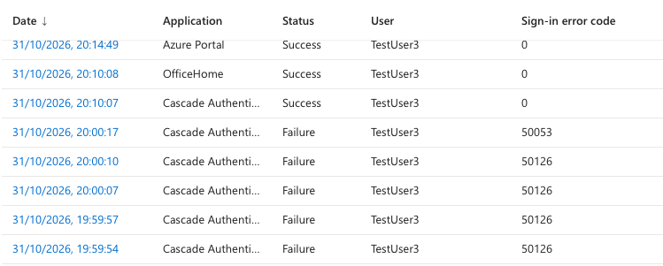

# 01 — Sign-in logs 

## Account locked (TestUser3)
User says their account is locked.

1. TestUser3 signed in with ~10 different wrong passwords.
2. Entra > Monitoring & health > Sign-in logs, filter: TestUser3, Status: Failure
3. Waited ~ 60 s, signed withthe correct password

| Code | Meaning |
|---|---|
| 50126 | Invalid username or password |
| 50053 | Account locked (Smart Lockout) |

**Observations:**
- Smart Lockout ignores the same wrong password repeated - each attempt must be different to count.
- One session, one person. Verdict: **Benign**.
- Location showed Bydgoszcz, I'm in Warsaw. ASN 13335 = Cloudflare, my Icloud Private Relay. Geo-UP is a guess; check the ASN first.

