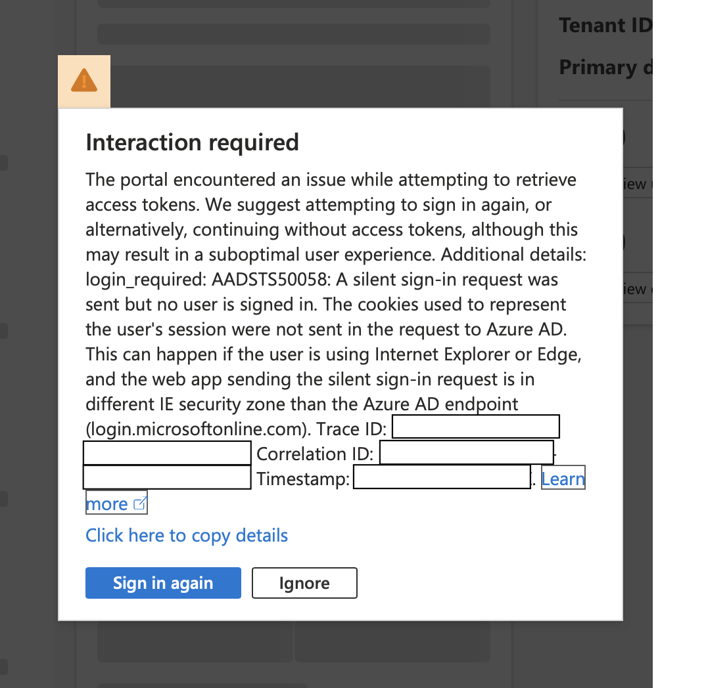
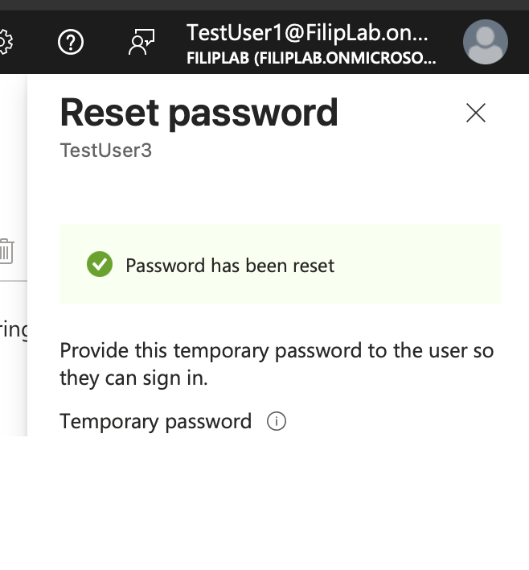

# 02 - MFA & passwords

## First sign-in (TestUser2)
Forced password change + MFA registration with Microsoft Authenticator (Security Defaults on).

## Lost phone (TestUser2)
User lost their phone and can't sign in with MFA.

1. (Admin) Entra > Users > TestUser2 > Authentication methods > **Require re-register MFA**
2. **Revoke sessions** - in case the phone is in the wrong hands
3. User signs in again and sets up Authenticator from scratch

**Observation:** revoke didn't log the user out immediately. The portal kept working for a few minutes, then failed with `AADSTS50058` when it tried to refresh the token. Existing access tokens stay valid until they expire, therefore for a compromised account I'd also reset the password and block sign-in.

## Forgotten password (TestUser3)
User forgot their password.

1. Entra > Users > All users > TestUser3 > **Reset password**
2. Entra generates a temporary password - the user must change it at first sign-in
3. User signs in with the temporary password and sets a new one

**Observation:** I did the reset from TestUser1 (SecOp), expecting it to fail - it worked. Entra audit logs confirmed it: "Reset password (by admin)", initiated by TestUser1.
Lesson: don't assume role permissions - **check them**.

**Note:** Password reset is available in both portals. Entra always forces a password change at next sign-in. Admin center lets you choose (checkbox: *Require this user to change their password when they first sign-in*).

