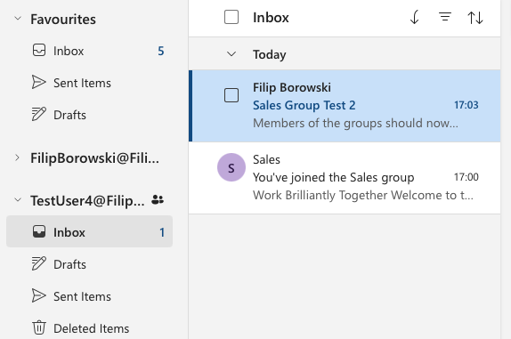
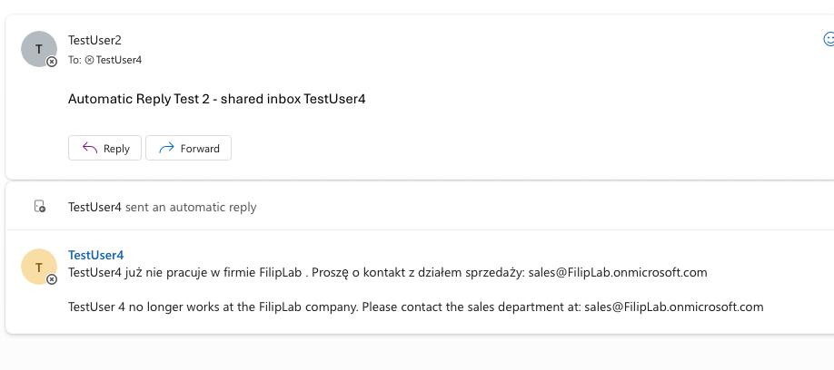
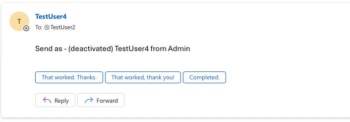

# 03 - Onboarding & offboarding

## Onboarding (TestUser4)
New employee in Sales.

1. Admin center > Users > Active users > **Add a user** - Business Premium license, job title, department
2. Teams & groups > **Add a Microsoft 365 group** "Sales", TestUser4 as member

**Issue:** emails sent to the group didn't show up in TestUser4's Inbox - only under Groups.

**Fix:** group Settings > **Send copies of group conversations and events to group members' inboxes**.

## Offboarding (TestUser4)
Employee leaves the company.

1. **Block sign-in**
2. **Reset password**
3. **Revoke sessions** (Entra) - block sign-in stops new sign-ins, revoke kills existing ones.
4. Mail > **Convert to shared mailbox** and give the manager access
5. Remove from the Sales group
6. Remove the license - **always last**

**Why this order:** a shared mailbox doesn't need a license. Remove the license first and the mailbox gets deleted after 30 days.

**Note:** OneDrive is only created on the user's first visit - TestUser4 never opened it, so there were no files to hand over.

**After converting to shared mailbox:**
- **Automatic replies** (PL + EN) - senders are told who to contact instead
- **Send As** for the manager - they can reply from TestUser4's address
- **Sent items:** *Copy items sent as/on behalf of this mailbox* - otherwise sent mail lands in the sender's Sent Items
- **Hide from GAL (Global Address List)** - address book update can take hours

**Send As vs Send on Behalf:** the recipient sees only TestUser4 vs "… on behalf of TestUser4".

