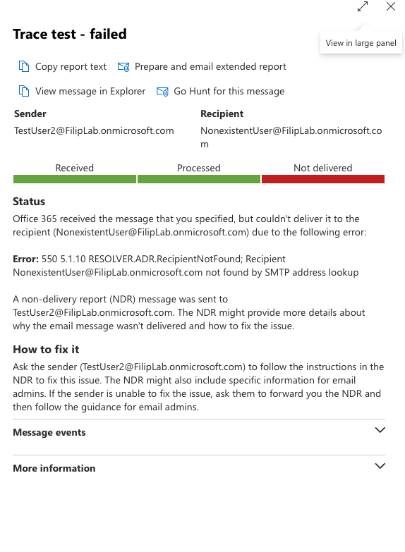

# 04 - Message trace 

## "My email didn't arrive" (TestUser2)

1. TestUser2 sent two emails: one to TestUser3, one to a non-existent address
2. Exchange admin center > Mail flow > **Message trace** > sender: TestUser2 

| Recipient | Status | Events |
|-|-|-|
| TestUser3 | Delivered | Receive > Submit > Deliver |
| NonexistentUser | Failed | Receive > Submit > Fail | 

**Error:** `550 5.1.10 RecipientNotFound` - the address doesn't exist in the organisation.
- **5xx** = permanent failure, no retry
- **4xx** = temporary, the server retries (*Defer* events)

**Helpdesk tip:** ask for the exact recipient address, time and subject first. Most often it's a typo - compare the address from the NDR with the real one.

