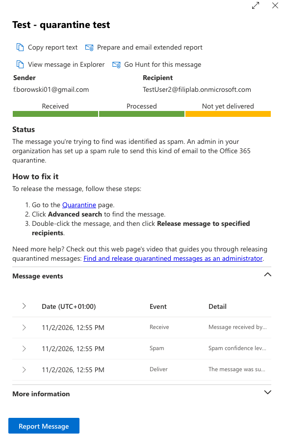
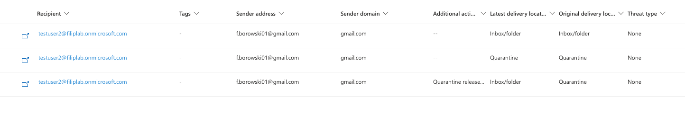

# 04 - Message trace 

## "My email didn't arrive" (TestUser2)

1. TestUser2 sent two emails: one to TestUser3, one to a non-existent address
2. Exchange admin center > Mail flow > **Message trace** > sender: TestUser2 

| Recipient | Status | Events |
|-|-|-|
| TestUser3 | Delivered | Receive > Submit > Deliver |
| NonexistentUser | Failed | Receive > Submit > Fail | 

**Error:** `550 5.1.10 RecipientNotFound` - the address doesn't exist in the organisation.
- **5xx** = permanent failure, no retry
- **4xx** = temporary, the server retries (*Defer* events)

**Helpdesk tip:** ask for the exact recipient address, time and subject first. Most often it's a typo - compare the address from the NDR with the real one.

## "An email from a client didn't arrive" (TestUser2)

**Setup:** I blocked my Gmail address in Defender > Tenant Allow/Block Lists, then sent an email from Gmail to TestUser2.

**L1:**
1. Ask the user: sender address, time, subject
2. Exchange admin center > Mail flow > **Message trace** > sender: Gmail address
3. Status: **Quarantined**, SCL 9, quarantine reason: **High confidence phish**
4. Defender portal > **Quarantine** > Email > **Release**

**Observations:**
- Message events show **Deliver** - but it was delivered to quarantine, not to the Inbox
- Message trace is located in Exchange admin center, quarantine is in the Defender portal
- The reason came from the block entry, not from the email content
- Release fixes one message, not the cause - the next message from the same sender was quarantined again
- Removing the block doesn't release emails already in the quarantine

**Escalate when:**
- Quarantine reason is High confidence phish or Malware - never released by L1
- Labelled Spam, but the content looks like phishing (unknown sender, "log in to see the invoice")

**L1 can release** when it's Spam, the sender address matches the known client **exactly**, and there are no suspicious link or attachments.

**L2 - deeper:**
- Removed the block entry in Tenant Allow/Block List - the next email arrived after 2 minutes
- Email headers (Outlook > View message details > `Authentication-Results`); spf=pass, dkim=pass, dmarc=pass
    - **SPF** - is the sending server authorised to send emails for this domain
    - **DKIM** - digital seal: the message comes from this domain and wasn't changed on the way
    - **DMARC** - checks whether SPF and DKIM match the From address the user sees, and says what to do if they don't

**Security view:** Defender > Email & collaboration > **Explorer** > filter: sender address
- Shows every email from this sender and every recipient - not just one message like message trace
- **Original** vs **Latest delivery location** - test 1: Quarantine > Inbox, with "Quarantine release" in Additional actions
- Threat type: None - the quarantine came from my block entry, not from detected content

