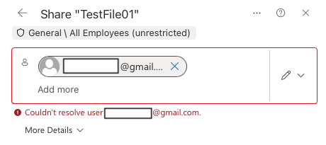

# 05 - OneDrive sharing

## "I can't see the file from my colleague" (TestUser2 > TestUser3)

1. TestUser2 uploaded a file to OneDrive > **Share** > **Specific people** > TestUser3, **Can view**
2. TestUser3 found it in **Shared with you** - could view, couldn't edit
3. TestUser2 > **Manage access** > changed TestUser3 to **Can edit** - now it works

**Link types:** Anyone, People in the organisation, People with existing access, Specific people

**Helpdesk tip:** first check **Manage Access** - who has access and with which permission.

## "I can't share a file with an external client"

1. SharePoint admin center > Policies > **Sharing** > OneDrive set to **Only people in your organisation**
2. TestUser2 tried to share with an external address > `Couldn't resolve user`
3. Reverted the setting > external invite worked

**Note:** the error doesn't say the external sharing is blocked - users will think they mistyped the address. Check the sharing policy first. If it's blocked on purpose, don't change it yourself - escalate.

