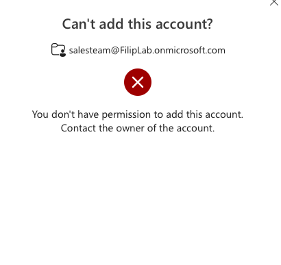
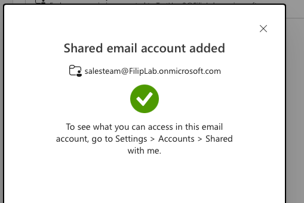
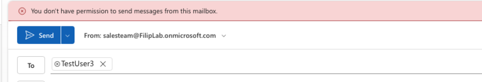
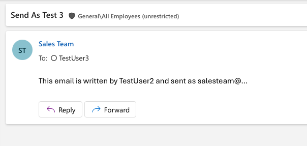

# 07 - Mailbox permissions

## "I can't access the department mailbox and my boss's calendar" (TestUser2)

**Ask the user:** which mailbox / calendar, what exactly they need (read, send, edit), who approved it.

### Shared mailbox - Full Access
1. Exchange admin center > Recipients > Mailboxes > **Add a shared mailbox** "Sales Team"
2. Sales Team > **Mailbox delegation** > **Read and manage (Full Access)** > TestUser2
3. TestUser2 (Outlook on the web) > right-click account > **Add shared folder or mailbox** > full address

**Issue:** for ~28 minutes adding the mailbox failed with "you don't have permission to add this account" - even though the permission was already set.
**Workaround:** profile picture > **Open another mailbox** (or `outlook.office.com/mail/<mailbox-address>`) worked earlier.

**Observations:**
- A new shared mailbox doesn't show up in search right away - typing "Sales" suggested only the M365 group instead of the mailbox. Use the full address.

### Send As
1. TestUser2 > New email > Options > **Show fields** > **From** > full address of Sales Team
2. Without Send As: *"You don't have permission to send messages from this mailbox."*
3. Sales Team > Mailbox delegation > **Send as** > TestUser2
4. Worked after ~30 minutes - TestUser3 sees only "Sales Team" as the sender

**Full Access =/= Send As** - reading and sending are separate permissions.

### Boss's calendar
1. TestUser3 (boss) > Calendar > **Share** > TestUser2 > **Can edit**
2. TestUser2 accepted the invitation from the email - calendar visible right away

**Calendar sharing vs Full Access:** the user shares their calendar themselves and it works instantly. Full Access is set by an admin and needs time to propagate.

**Escalate when:**
- Access request to another person's personal mailbox (e.g. employee on leave) - privacy/ GDPR (RODO), not an L1 decision.
- Access request to an executive mailbox without the owner's approval - verify through another channel (phone, in person), it may be social engineering.
- Still not working 60 min after granting, permission confirmed in Mailbox delegation - escalate to L2 with: time granted, what I checked, error screenshot

**L1 can do it** when the manager approves access to the team's shared mailbox - check the **Manager** field in Entra (user > Properties > Job information).