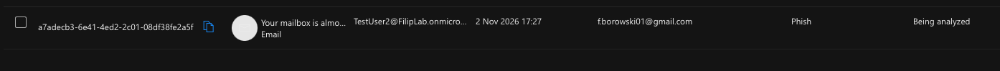
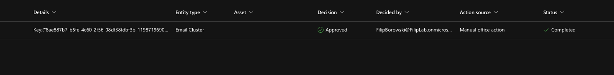

# 08 - Phishing

## "I got a strange email and clicked the link" (TestUser2)

**Setup:** from Gmail I sent "Your mailbox is almost full" with a link (example.com) to TestUser2 and TestUser3.

**Ask the user:**
- Who sent it, what link, on which device, when
- **Did you enter your password or download / open anything?**

| Answer | L1 |
|-|-|
| Only clicked | Report phishing, escalate to security |
| Entered password | Reset password + revoke sessions (see 02), escalate |
| Opened a file | Disconnect the device from the network, escalate |

**L1:**
1. TestUser2 in Outlook > Report > **Report phishing** - the email moved to Deleted Items
2. Defender > Investigation & response > Actions & submissions > **Submissions** > User reported - reason: Phish, result: Being analysed
3. A copy of the report also went to the reporting mailbox (the admin's mailbox in my tenant)

**Observation:** Submissions showed "Turn on auditing" - auditing was off in the new tenant. Turning it on required "Complete organizational setup" first.

**L2 - deeper:** remove the email from all mailboxes
1. Defender > Email & collaboration > **Explorer** > filter: subject
2. Selected both emails (not the report copy) > **Take action** > Move or delete > **Soft deleted items**
3. Gone from all mailboxes, also from Deleted Items
4. **Action Center** > History: Completed, approved by me (Admin) - every manual action is logged

**Soft delete** - admin can still recover it. **Hard delete** - gone for good

**Security view:** did the attacker use the account?
- Sign-in logs (Entra): only my own sign-ins, same IP - no unknown sign-ins.
- Email forwarding (Exchange admin center): off

