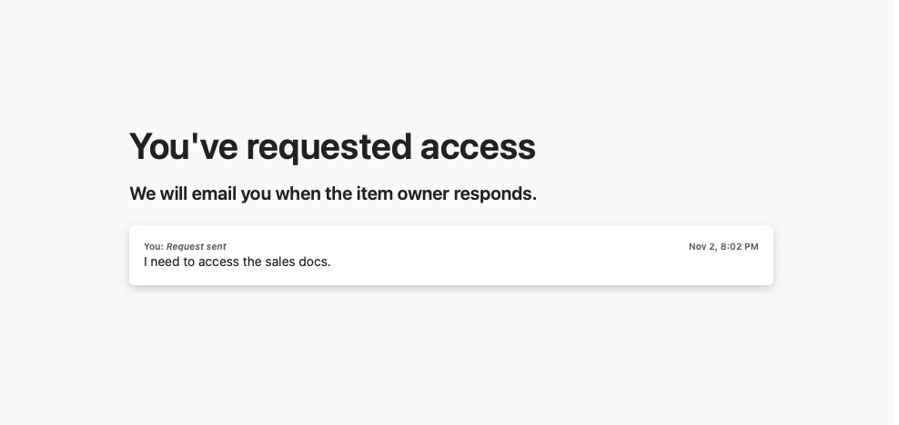

# 09 - SharePoint

## "I can't access the site" (TestUser1)

The Sales site belongs to the M365 group "Sales" (created in 03). TestUser1 is not in the group.

**L1:**
1. SharePoint admin center > Sites > Active sites > Sales > **Membership** - owner: TestUser2
2. TestUser1 opened the site URL > no access > **Request access** with a message
3. The request went by email to the **site owner** (TestUser2), not to IT
4. Owner chose the access level: **Sales Visitors [Read]** - the user only needed to read
5. TestUser1 could open documents, but couldn't edit or upload

**Site permissions:**
- Site owners > Sales Owners (M365 group owners)
- Site members > Sales Members (M365 group members)
- Site visitors > TestUser1 (added individually)

**Observation:** the site takes access from the M365 group - everyone in the Sales team has access. Full team access = add to the M365 group. Only reading documents = Visitors.

**Escalate when:**
- The site owner doesn't respond - first check if there's a second owner, otherwise escalate. L1 doesn't decide for the owner
- External sharing is blocked - if on purpose, don't change it (see 05), escalate
- A user sees files they shouldn't (e.g. HR salaries) - security incident: ask the user not to open or share the files, note the link and escalate. Don't fix the permissions yourself.

