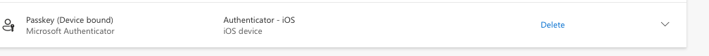
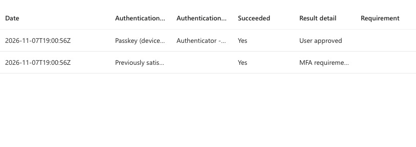
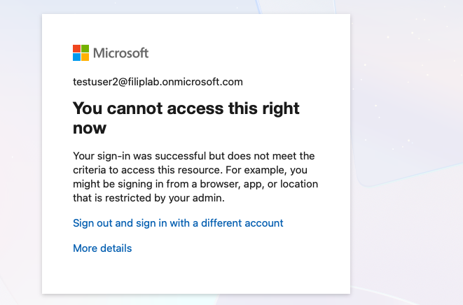
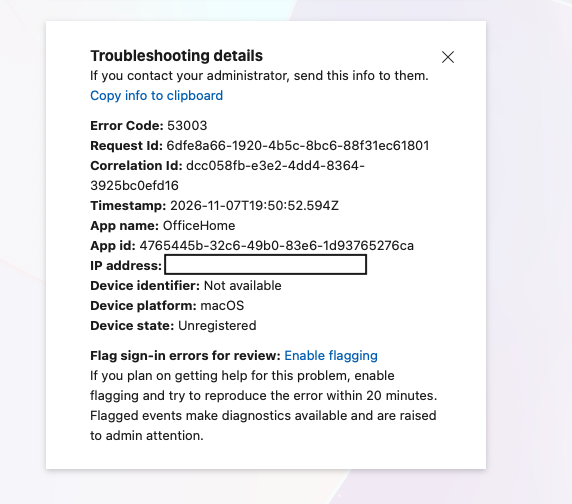
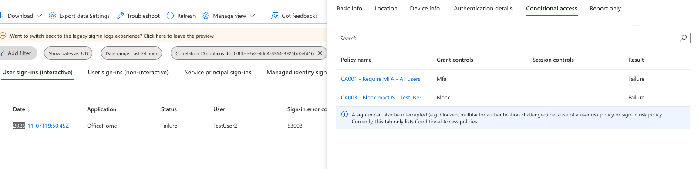

# 10 - Conditional Access

**Setup:**
1. Create a cloud-only **break glass** account (`breakglass01@filiplab.onmicrosoft.com`) with a permanent **Global Administrator** role, no license.
2. Create a group **CA-Exclude-BreakGlass** and exclude it from every CA policy.
3. Entra admin center > Entra ID > Authentication methods > turn on **Passkey (FIDO2)** for this group. Then register a passkey in Microsoft Authenticator (device-bound).

**Observation:** first sign-in in the sign-in logs:
- **50055** (Interrupted) - forced change of the temporary password
- **50140** - the "Stay signed in?" prompt, not an error
- Authentication details: **Passkey (device-bound)** and no password row - a passkey is MFA without a password 
- "Previously satisfied" = MFA was already done earlier in the same sign-in, so read the logs in pairs

**Recommendations:**
- 2 break glass accounts, so one isn't a single point of failure
- Permanent Global Admin, excluded from all CA policies (also role-based ones)
- MFA is mandatory for admin portals since 2024 - use a phishing-resistant method (FIDO2 key or certificate)
- Alert on every sign-in of these accounts
- Test them regularly

**From Security Defaults to CA:**
1. CA gives the company more control over the access to the system. It allows for more complex and detailed needs of the company. However, it is easier to make a mistake in configuration or forget about certain details leading to access problems or vulnerabilities. Security Defaults is recommended for small businesses whose security team is not fluent in setting and maintaining CA policies. Security Defaults and CA can't be used together - Security Defaults must be turned off first.
2. First two policies I created were (both exclude **CA-Exclude-BreakGlass**):
    - **CA001 - Require MFA - all users**
    - **CA002 - Block legacy authentication** - Client apps: Exchange ActiveSync + Other clients, Block
3. **Report-only** first:
    - break glass: Not applied (excluded)
    - TestUser2: CA001 "User action required", CA002 Not applied (browser) - the sign-in still succeeded with just the password, because Report-only doesn't enforce
4. Switched to **On**: TestUser2 had to approve in Microsoft Authenticator. CA001: Success, Authentication policies applied changed from **Security Defaults** to **Conditional Access**.
5. Obstacles that occurred in the process:
    - Templates exclude **Current user** by default - it should be the break glass group, not my admin account
    - "Don't lock yourself out!" warning - Proceed was safe only because break glass was excluded
    - CA002 didn't save as On - I caught it in **What If** (state: Report-only). Always check the state after saving
    - Between turning off Security Defaults and turning CA001 On there was no MFA at all - keep that gap as short as possible

**Policy evaluation:**
1. Entra evaluates all CA policies that match the sign-in at the same time - there is no order.
2. **Block** wins over any other requirement. If one policy blocks, MFA from other policies doesn't matter.
3. Requirements from all matching policies are summed and user needs to satisfy all of them.
4. **Not applied** means the action didn't match the conditions of the policy, so it took no part in the decision. It's not an error.
5. **Report-only** shows what the effect of the policies would be. Used to test a policy before turning it on - results in the **Report only** tab of the sign-in logs. They don't take action unless set to **On**.

## Ticket: "I can't sign in on my Mac" Error message: **53003** sign-in blocked by Conditional Access

**Ask the use:r**
1. Ask the user:
- "What is the error message?"
- "Have you used a different device this time?"
- "Have you tried other devices?"
- "Have you tried other browsers?"
- "Are you using a VPN?"
- "Are you working from home or travelling?"
- "When did it start? Did it work before on this device?"
- "What app are you having trouble with?"
- Ask the user to send you details: **more details** > **copy info to clipboard**.

**L1:*
1. Do not reset the password if it was the user.
2. Entra admin center > Monitoring & health > Sign-in logs > correlation id: **use the user's correlation ID** > Conditional Access tab: which policy shows **Failure**
3. Check the Location and Device Info to confirm the sign-in matches what the user reported (exclude FP).
4. Explain to the user the company's policy that applied here. Ask why the user needs access from this device, and escalate if needed.

**Escalate when:**
- The user needs access from a device or location the policy blocks - exceptions to CA policies are not an L1 decision. Escalate to L2/admin with: correlation ID, name of the failed CA policy, the user's business reason.
- The location or device in the sign-in log doesn't match what the user reported - possible account takeover. Escalate to security. Don't unblock access or change the policy - CA did its job.
- The same error 53003 is reported by many users at the same time - likely a recent change in a CA policy. Don't change the policy yourself. Escalate to L2 with: list of affected users, when it started, name of the failed policy.

**L2 - deeper:**
1. Check the policy that failed: Entra admin center > Entra ID > Conditional Access > Policies > **CA003 - Block macOS - TestUser2**. Check Users, Target resources, Conditions (Device platforms: macOS) and Grant (Block).
2. Simulate the sign-in: CA > Policies > **What If** - TestUser2, Office 365 Exchange Online, Browser, macOS. Result: CA001 + CA003 apply, CA002 doesn't (reason: Client app). What If doesn't sign anyone in and doesn't change anything.
3. Check recent changes: Entra ID > Monitoring & health > **Audit logs** > Service: Conditional Access - **Initiated by**, time, and **Modified properties** (old/new value, e.g. `enabledForReportingButNotEnforced` > `enabled`).
4. Decide:
    - Policy is right > explain it to the user and close the ticket.
    - User need an exception > add them to an exclusion group (like `CA-Exclude-Breakglass`), never directly to the policy. The security team / policy owner approves it, document why.
    - Policy is wrong > the admin/security team decides on the fix. Change it in **Report-only**, check with What If and sign-in logs, then switch to **On**.

**Security view:**
1. 53003 means the password was correct - whoever signed in knows the login and password. CA blocked it only because of the device platform. If the password was stolen, CA stopped the attacker.
2. Before confirming an incident, rule out FP: VPN, travelling, a private device.
3. If the user confirms it wasn't them: reset the password + revoke sessions. (see 02)
4. Check what else the attacker could've done:
    - Sign-in logs: successful sign-ins from the same IP, e.g. from another platform CA003 doesn't block
    - Authentication methods: did the attacker add their own MFA method?
    - Mailbox: inbox rules and forwarding (see 08)
5. Escalate as an incident right away.
6. Second lead: a compromised admin could change or disable a CA policy - check Audit logs (Service: Conditional Access, Initiated by)

